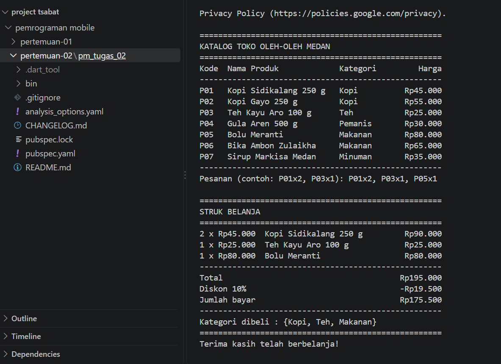
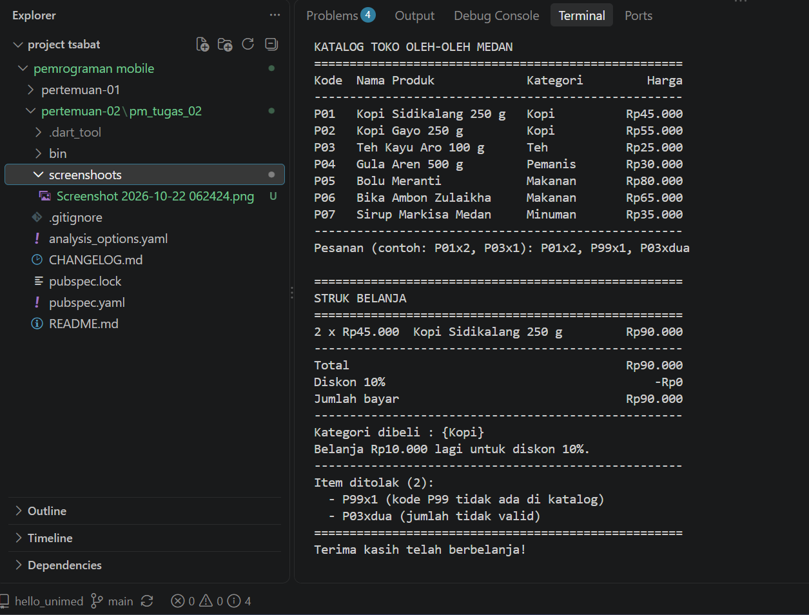

# Tugas Rutin 2 — Aplikasi Console Kasir Sederhana

Pemrograman Mobile (3KOM40215) · Pertemuan 2 · Ilmu Komputer UNIMED

## a. Identitas

| | |
|---|---|
| Nama  | Muhammad Tsabat Muhyiyuddin |
| NIM   | 4243250002 |
| Kelas | PSIK24D |
| GitHub | [tsabat15](https://github.com/tsabat15) |

## Cara menjalankan

```powershell
dart pub get
dart run bin/kasir.dart
```

Format pesanan: `KODExJUMLAH` dipisah koma, misalnya `P01x2, P03x1`.
Huruf `x` boleh kecil/besar, kode yang sama digabung (`P01x2, P01x1` → P01 = 3).

Fitur:
- Katalog `Map<String, record>` berisi 7 produk, ditampilkan sebagai tabel rapi (`padRight`/`padLeft`).
- Input diurai dengan `split`, `trim`, dan `int.tryParse`.
- Kode tidak dikenal, jumlah bukan angka/≤ 0, atau format salah **dicatat sebagai item ditolak**, program tidak crash.
- Subtotal dihitung dengan `map`, total dengan `fold`; diskon 10% bila total ≥ Rp100.000.
- Struk menampilkan setiap item, total, diskon, jumlah bayar, `Set` kategori yang dibeli, dan daftar item ditolak.
- Tanpa `dynamic` dan tanpa operator `!`.

## b. Tangkapan layar

### Skenario 1 — pesanan valid

Input: `P01x2, P03x1, P05x1`



```
====================================================
STRUK BELANJA
====================================================
2 x Rp45.000  Kopi Sidikalang 250 g         Rp90.000
1 x Rp25.000  Teh Kayu Aro 100 g            Rp25.000
1 x Rp80.000  Bolu Meranti                  Rp80.000
----------------------------------------------------
Total                                      Rp195.000
Diskon 10%                                 -Rp19.500
Jumlah bayar                               Rp175.500
----------------------------------------------------
Kategori dibeli : {Kopi, Teh, Makanan}
====================================================
```

### Skenario 2 — pesanan mengandung kode salah

Input: `P01x2, P99x1, P03xdua`



```
====================================================
STRUK BELANJA
====================================================
2 x Rp45.000  Kopi Sidikalang 250 g         Rp90.000
----------------------------------------------------
Total                                       Rp90.000
Diskon 10%                                      -Rp0
Jumlah bayar                                Rp90.000
----------------------------------------------------
Kategori dibeli : {Kopi}
Belanja Rp10.000 lagi untuk diskon 10%.
----------------------------------------------------
Item ditolak (2):
  - P99x1 (kode P99 tidak ada di katalog)
  - P03xdua (jumlah tidak valid)
====================================================
```

Kode `P99` tidak ada di katalog dan jumlah `dua` bukan angka, tetapi program
tidak crash: keduanya dicatat sebagai item ditolak dan pesanan lain tetap
diproses.

## c. Penjelasan: var, final, const, dan null safety

`var` dipakai untuk variabel yang nilainya masih berubah, contohnya penghitung
`i` pada perulangan struk (`for (var i = 0; ...)`). `final` hanya diisi sekali
saat program berjalan; hampir semua variabel di program ini `final`, misalnya
`input`, `total`, dan `diskon`, karena setelah dihitung nilainya tidak diubah
lagi. `const` nilainya sudah diketahui saat kompilasi, seperti `batasDiskon`
dan `persenDiskon`, sehingga aturan diskon cukup diubah di satu tempat.

Null safety mencegah crash di tiga titik. Pertama, `stdin.readLineSync()`
bertipe `String?`, jadi diberi pengganti `?? ''` (baris 69). Kedua,
`int.tryParse()` mengembalikan `int?`; input seperti `P03xdua` menghasilkan
`null` lalu dicek di baris 93 dan masuk daftar ditolak, berbeda dengan
`int.parse()` yang akan melempar exception. Ketiga, `katalog[kode]` bertipe
`Produk?` karena kode bisa tidak ada. Kode dicek dengan `containsKey`
(baris 98), lalu pola `if (katalog[kode] case final produk?)` (baris 109)
memastikan `produk` tidak null tanpa memakai operator `!`. Penjumlahan
`(jumlahPerKode[kode] ?? 0) + jumlah` (baris 102) juga memakai `??` karena
kode yang baru pertama kali muncul belum punya nilai.

## d. Pernyataan penggunaan AI

Saya menggunakan asisten AI untuk:

- memasang Dart SDK 3.13.4 dan membuat proyek console;
- menyusun `bin/kasir.dart` dari kerangka awal modul (TODO 1–5), termasuk
  format Rupiah, penggabungan kode yang sama, dan daftar item ditolak;
- menguji skenario pesanan valid dan pesanan dengan kode/jumlah salah;
- membuat draf README dan penjelasan bagian (c), yang kemudian saya baca dan
  sesuaikan.

Dari tugas ini saya belajar bahwa akses `Map` selalu menghasilkan nilai
nullable, mengapa `int.tryParse` lebih aman daripada `int.parse` untuk input
pengguna, cara memakai pola `case final x?` sebagai pengganti operator `!`,
serta cara merangkai `map` dan `fold` untuk menghitung total belanja.
